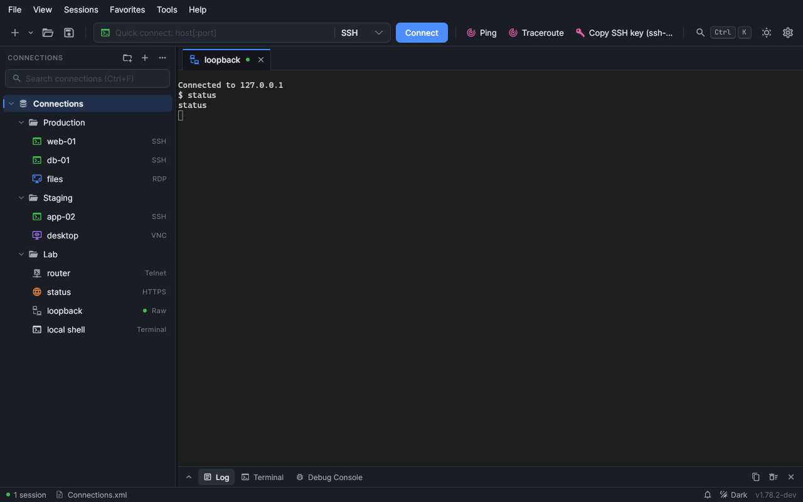
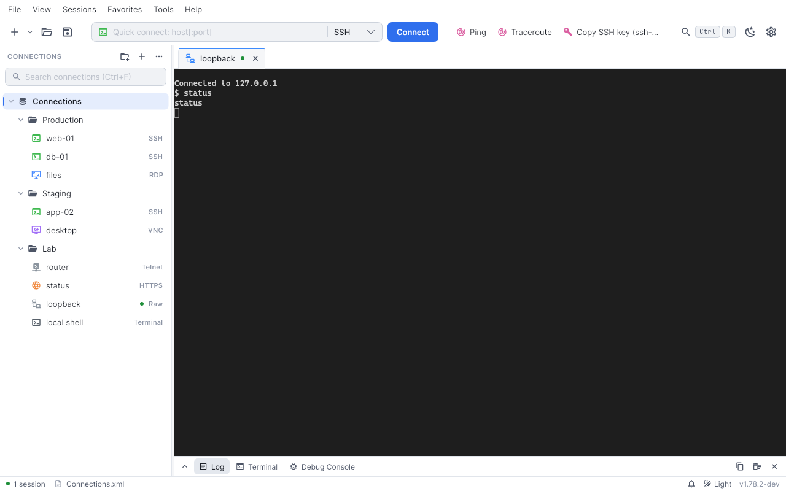
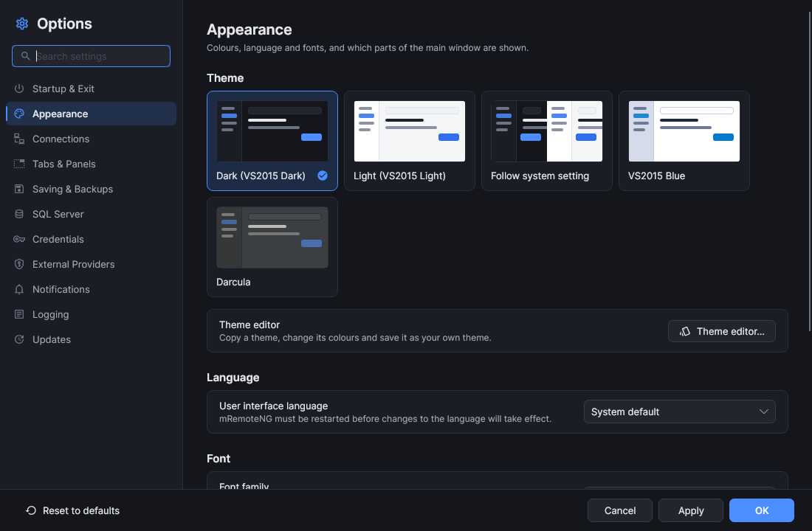
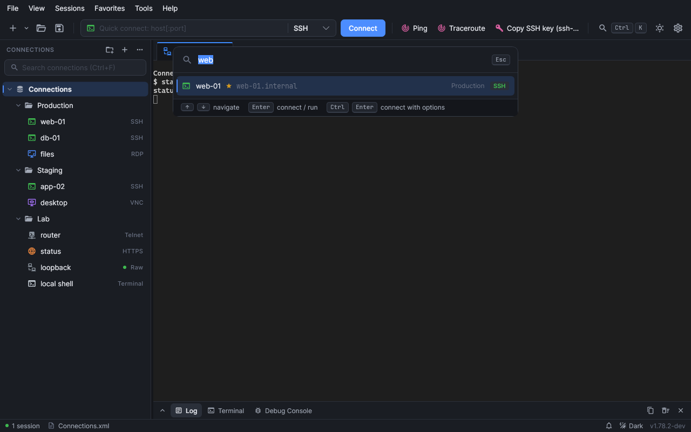

<p align="Left">
	Developing mRemoteNG to its fullest potential is my personal priority.<br>
While the project remains non-commercial, it does come with ongoing costs — including VPS hosting for testing, AI tools, domain fees, and more. <br> If you find value in mRemoteNG and want to support its future, even a small donation from our community can make a huge difference.<br>
Your support helps me keep the project secure, modern, and accessible for everyone who relies on it — and brings us closer to a brighter, more collaborative future.<br><br>
Consider donating — every contribution counts!
	<br><br>
	<a href="https://www.paypal.com/paypalme/mremoteng">
    	
	</a><br>
	<a href='https://ko-fi.com/Q5Q41I7JS' target='_blank'></a>
  </a>
</p>

---

<p align="center">
  
</p>
  
<p align="center">
  An open source, multi-protocol, tabbed remote connections manager allowing you to view all of your connections in a simple yet powerful interface
</p>

## Screenshots

The cross-platform app, on Windows, Linux and macOS. The same connection file opens in the classic Windows app.

<p align="center">
  <br>
  <em>Main window, dark theme</em>
</p>

<p align="center">
  
  <br>
  <em>Light theme, and Options → Appearance</em>
</p>

<p align="center">
  <br>
  <em>Command palette (Ctrl+K)</em>
</p>

<p align="center">
  
</p>

<p align="center">
  <a href="https://www.reddit.com/r/mRemoteNG/">
    
  </a>
  <a href="https://twitter.com/mremoteng">
    
  </a>
  <a href="https://app.element.io/#/room/#mremoteng:matrix.org">
    
  </a>  
</p>

<p align="center">
  <a href="https://github.com/mRemoteNG/mRemoteNG/blob/develop/COPYING.TXT">
    
  </a>
  <a href="https://bestpractices.coreinfrastructure.org/projects/529">
    
  </a>
  <a href='https://mremoteng.readthedocs.io/en/latest/?badge=latest'>
    
  </a>
  <a href="https://gurubase.io/g/mremoteng">
    
  </a>
</p>

---

| Channel | Build Status | Downloads |
| ---------------|--------------|-----------|
| Stable |  | [](https://github.com/mRemoteNG/mRemoteNG/releases/tag/v1.76.20) |
| Preview |  | [](https://github.com/mRemoteNG/mRemoteNG/releases/tag/v1.77.1) |
| Nightly |  | [/total.svg)](https://github.com/mRemoteNG/mRemoteNG/releases/tag/20250916-v1.78.2-NB-(3177)) |

## Features

The following protocols are supported:

* RDP (Remote Desktop Protocol)
* VNC (Virtual Network Computing)
* SSH (Secure Shell)
* Telnet (TELecommunication NETwork)
* HTTP/HTTPS (Hypertext Transfer Protocol)
* rlogin (Remote Login)
* Raw Socket Connections
* Powershell remoting
* AnyDesk

For a detailed feature list and general usage support, refer to the [Documentation](https://mremoteng.readthedocs.io/en/latest/).

## This fork

[Morgadoo/mRemoteNG](https://github.com/Morgadoo/mRemoteNG) is the cross-platform edition. Development stays on the `dev` branch of this fork.

New work from [mRemoteNG/mRemoteNG](https://github.com/mRemoteNG/mRemoteNG) `v1.78.2-dev` is merged in here. Nothing from this fork is pushed or pull-requested back to that repository.

```bash
git remote add upstream https://github.com/mRemoteNG/mRemoteNG.git   # once
git fetch upstream
git checkout dev
git merge upstream/v1.78.2-dev
```

## Build environment

This project must be built on Windows using Visual Studio 2026 tooling. Use the MSBuild.exe from the Visual Studio 2026 installation instead of the .NET Core `dotnet build` fallback; the Windows desktop project requires the Visual Studio build environment and COM/desktop targets.

For local builds, prefer:

```powershell
& "$env:ProgramFiles(x86)\Microsoft Visual Studio\2026\Enterprise\MSBuild\Current\Bin\MSBuild.exe" mRemoteNG.sln /p:Configuration=Debug /p:Platform=x64
```

If your installation path differs, locate the VS2026 MSBuild from `vswhere.exe` first and then call that `MSBuild.exe` explicitly.

## Plugin development workflow

Plugin projects are built from a separate plugin-only solution and loaded from the app's plugin folder at runtime.

To build the plugin set:

```powershell
dotnet build mRemoteNG.Plugins.sln -c Release -p:Platform=x64
```

Then copy the generated plugin DLLs into the app plugin folder, while keeping the shared contracts assembly in the app's `Assemblies` folder:

The example below uses the x64 output path. For ARM64 builds, replace `x64` with `arm64`.

```powershell
Copy-Item .\mRemoteNG.PluginContracts\bin\x64\Release\net10.0-windows10.0.26100.0\mRp.Contracts.dll .\mRemoteNG\bin\x64\Release\Assemblies\
Copy-Item .\mRemoteNG.Plugins.PortScan\bin\x64\Release\net10.0-windows10.0.26100.0\mRp.PortScan.dll .\mRemoteNG\bin\x64\Release\Plugins\
Copy-Item .\mRemoteNG.Plugins.SshTransfer\bin\x64\Release\net10.0-windows10.0.26100.0\mRp.SshTransfer.dll .\mRemoteNG\bin\x64\Release\Plugins\
Copy-Item .\mRemoteNG.Plugins.AWS\bin\x64\Release\net10.0-windows10.0.26100.0\mRp.AWS.dll .\mRemoteNG\bin\x64\Release\Plugins\
Copy-Item .\mRemoteNG.Plugins.MultiAddress\bin\x64\Release\net10.0-windows10.0.26100.0\mRp.MultiAddress.dll .\mRemoteNG\bin\x64\Release\Plugins\
```

See [README.plugins.md](README.plugins.md) for the full workflow and details.

The WinForms app and the installer need that Visual Studio build. The cross-platform projects (`mRemoteNG.Avalonia`, `mRemoteNG.Core`, `mRemoteNG.Protocols`) build with the .NET 10 SDK on Windows, Linux and macOS.

## Installation

### Cross-Platform Installation

The cross-platform (Avalonia) app runs on Windows, Linux and macOS. The screenshots above are that app.
No packages are published to Flathub, the Snap Store, Homebrew or winget yet; build them with the scripts in
`packaging/`, or download the artifacts of the nightly workflow.

**Linux**
```bash
# AppImage (portable) — packaging/linux/build-appimage.sh
chmod +x mRemoteNG-*.AppImage && ./mRemoteNG-*.AppImage

# Debian/Ubuntu — packaging/linux/build-deb.sh
sudo apt install ./mremoteng_*.deb
```

For RDP install FreeRDP 3 (`sudo apt install freerdp3-x11`); everything else (SSH, SFTP, VNC, Telnet, …) is
built in.

```bash
# Flatpak — builds the committed HEAD, installs it for the current user
./packaging/linux/build-flatpak.sh --bundle      # also writes dist/flatpak/mRemoteNG.flatpak
flatpak run org.mremoteng.mRemoteNG

# Snap — needs snapcraft (snap install snapcraft --classic)
cd packaging/linux && snapcraft pack
sudo snap install --dangerous mremoteng_*.snap && sudo snap connect mremoteng:ssh-keys
```

The Flatpak and the Snap include FreeRDP 3 (with Kerberos in the Flatpak) and the unixODBC driver manager.
They are sandboxed. The app can only start programs that are inside the package, so External Tools and
IntApp do not see the host's terminal emulators or tools, and PowerShell connections need `pwsh` inside the
sandbox. SQL storage over ODBC needs a driver inside the sandbox too: put the driver's `.so` under your home
folder and register it in `~/.odbcinst.ini` (in the Snap, `~` is `~/snap/mremoteng/current`), because the
host's `/usr/lib` and `/etc/odbcinst.ini` are not visible. For Kerberos in the Flatpak, the KDC is found through DNS, because the host's `/etc/krb5.conf` is not
visible either.

SQL storage over ODBC (Options ▸ SQL Server ▸ ODBC data source) also works outside the packages. On Linux
and macOS it needs unixODBC (`sudo apt install unixodbc`, `brew install unixodbc`) and the database's ODBC
driver; on Windows it uses the ODBC Data Source Administrator.

**macOS** — `packaging/macos/build-dmg.sh` builds a DMG; RDP needs `brew install freerdp`.

**Windows** — the classic WinForms installer below; the cross-platform app runs from
`dotnet publish mRemoteNG.Avalonia -r win-x64` (RDP needs FreeRDP's `wfreerdp.exe`).

Moving from the Windows app? See the [migration guide](docs/user-migration-guide.md): existing `confCons.xml`
files, including master passwords, open unchanged.

### Supported Operating Systems

- [Windows 11](https://en.wikipedia.org/wiki/Windows_11)
- [Windows 10](https://en.wikipedia.org/wiki/Windows_10)
- [Windows 8.1](https://en.wikipedia.org/wiki/Windows_8.1)
- [Windows Server 2022](https://en.wikipedia.org/wiki/Windows_Server_2022)
- [Windows Server 2019](https://en.wikipedia.org/wiki/Windows_Server_2019)
- [Windows Server 2016](https://en.wikipedia.org/wiki/Windows_Server_2016)
- [Windows Server 2012 R2](https://en.wikipedia.org/wiki/Windows_Server_2012_R2)
- Linux (Debian/Ubuntu, Fedora, Arch and derivatives) — x64 and ARM64
- macOS 12 Monterey and later — Apple Silicon and Intel

#### Source package

This contains the source code from which mRemoteNG is built.
You will need to compile it yourself using Visual Studio or the .NET 10 SDK.

### Minimum Requirements

Make sure you have the latest version installed:

* [Microsoft .NET Desktop Runtime 10.0](https://dotnet.microsoft.com/download/dotnet/10.0)
* Microsoft Visual C++ Redistributable 2015–2026 is needed:
 - [x64](https://aka.ms/vs/18/release/vc_redist.x64.exe)
 - [ARM64](https://aka.ms/vs/18/release/vc_redist.arm64.exe)
 - [x86](https://aka.ms/vs/18/release/vc_redist.x86.exe)
* Microsoft Terminal Service Client 6.0 or later (needed if you use RDP with mstscax.dll and/or msrdp.ocx to be registered)

### Download

> Starting Windows 11 you can use winget to install mRemoteNG. Just run `winget install -e --id mRemoteNG.mRemoteNG`

mRemoteNG is available as a redistributable MSI package or as a portable ZIP package and can be downloaded from the following locations:
* [GitHub](https://github.com/mRemoteNG/mRemoteNG/releases)
* [Project Website](https://mremoteng.org/download)

### Command line install

The MSI package of mRemoteNG can be installed using the command line:

`msiexec /i C:\Path\To\mRemoteNG-Installer.msi [/qn] [INSTALLDIR=value] [IGNOREPREREQUISITES=value] [/lv* <log path>]`

**Note on privileges**: The MSI installer supports dual-mode installation. By default, it will prompt for an installation scope in the UI. When running silently (`/qn`), it skips the UI and installs **per-machine** by default (which requires Administrator privileges). If you want to silently install it for the current user without requiring Administrator privileges, you must set the `MSIINSTALLPERUSER=1 ALLUSERS=2` properties from the command line.

| Argument/Property | Value | Description |
|-|-|-|
| /qn | `Silent Installation` | Will run the installer silently in the background. |
| /lv* | `Silent Installation` | Will write a logfile to the specified location. (For paths that contain spaces, enclose the path in double quotes) |
| INSTALLDIR | `folder path` | Allows you to set the installation directory from the command line. (For paths that contain spaces, enclose the path in double quotes) |
| IGNOREPREREQUISITES | `0` or `1` | When set to `1`, the installer will not be halted if any prerequisite check is not met. Administrator privileges are still required for a per-machine installation. |
| ALLUSERS | `2` | Enables single-package authoring so `MSIINSTALLPERUSER` can select the installation scope. |
| MSIINSTALLPERUSER | `1` | With `ALLUSERS=2`, installs for the current user; omit this property for a per-machine installation. |

## Manual Uninstall

_If you are using the Portable version, simply deleting the folder that contains mRemoteNG should be sufficient. These uninstall instructions are only necessary for the normal binary .MSI installed version of mRemoteNG_

* Delete the folder where mRemoteNG was installed. By default, this is:
	`%PROGRAMFILES%\mRemoteNG` (for versions before 1.77 on a x64 Windows its `%programfiles(x86)%\mRemoteNG`)

* Delete the mRemoteNG install entry from the following location. You may search for "mRemoteNG" in the DisplayName field:
  * x86 Windows or mRemoteNG starting with v1.77: `HKLM\SOFTWARE\Microsoft\Windows\CurrentVersion\Uninstall\`
  * x64 Windows and mRemoteNG before 1.77: `HKLM\SOFTWARE\WOW6432Node\Microsoft\Windows\CurrentVersion\Uninstall\`
* Remove the following registry key: `HKLM\SOFTWARE\mRemoteNG` (on x64 Windows with mRemoteNG before 1.77 it's `HKLM\SOFTWARE\WOW6432Node\mRemoteNG`)

* (Optional) If you would also like to delete user data remove `%LOCALAPPDATA%\mRemoteNG`
* (Optional) If you would also like to remove the connection configuration, delete `%APPDATA%\mRemoteNG`

* (Optional) If no other software uses it, the "Microsoft Windows Desktop Runtime" may be uninstalled too.

## Featured Projects

* [PSmRemoteNG](https://github.com/realslacker/PSmRemoteNG) A module to create mRemoteNG connection files from PowerShell.
* [mRemoteNGOpenVPN](https://github.com/T3los/mRemoteNGOpenVPN) A script that can be embedded as an external tool to control OpenVPN.
* [mRemoteNG-Icons](https://github.com/bearlikelion/mRemoteNG-Icons) A collection of fancy icons to customize the connections

## Contribute

If you find mRemoteNG useful and would like to contribute, it would be greatly appreciated. When you contribute, you make it possible for the team to cover the costs of producing mRemoteNG.

### Submit Code
Open a pull request against the `dev` branch of this fork. The [upstream wiki](https://github.com/mRemoteNG/mRemoteNG/wiki) describes the development environment.

### Translate
Check out the [Wiki page](https://github.com/mRemoteNG/mRemoteNG/wiki) on how to help make mRemoteNG a polyglot.

</br>
<p align="center">
  
</p>
